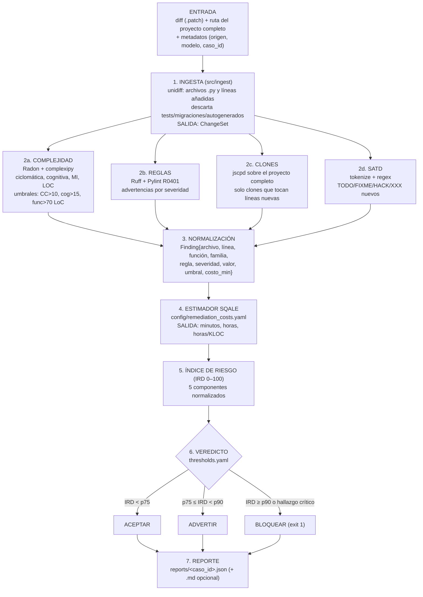
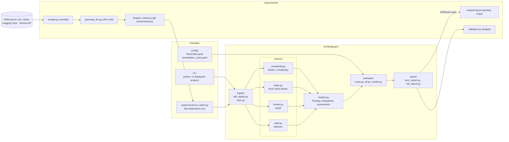
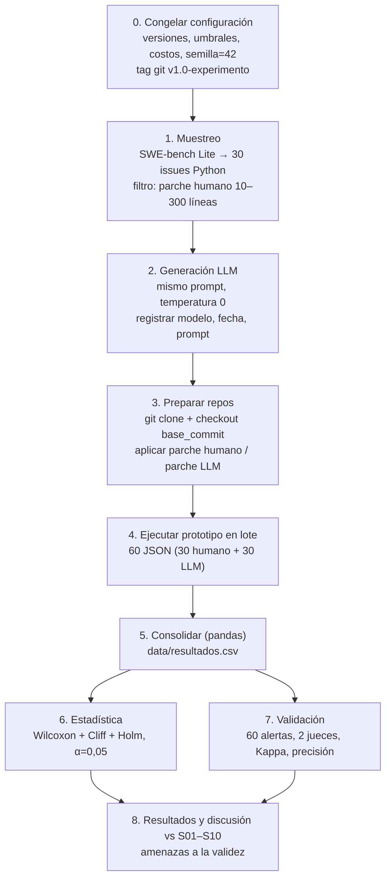

# Guía de desarrollo — Hito 2
## Prototipo de detección y estimación de deuda técnica en código generado por LLMs

> Documento de trabajo para el equipo. Reúne todo lo necesario para implementar el prototipo y ejecutar el experimento: diagramas, herramientas, datos, pasos, cronograma, problemas conocidos y consideraciones.
> Entrega: **10 de noviembre de 2026**. Hoy: 2 de noviembre → **8 días**.

---

## Índice
1. Resumen en una página
2. Decisiones cerradas (alcance mínimo)
3. Diagramas (flujo del prototipo, arquitectura, flujo del experimento)
4. Herramientas (con enlaces y licencias)
5. Datos: AIDev y SWE-bench Lite — qué se extrae y cómo
6. Cómo obtener el proyecto completo de un PR
7. Estructura del repositorio
8. Especificación de cada módulo (entrada → proceso → salida)
9. Modelo de costo tipo SQALE e índice de riesgo
10. Diseño experimental (hipótesis, variables, pruebas)
11. Pasos de implementación (orden exacto)
12. Cronograma de 8 días y reparto
13. Validación del prototipo
14. Problemas conocidos y cómo tratarlos (amenazas a la validez)
15. Consideraciones técnicas (tokens, límites, reproducibilidad, ética)
16. Checklist de entrega
17. Preguntas frecuentes para la exposición

---

## 1. Resumen en una página

| Elemento | Definición |
|---|---|
| Problema | El código generado por LLMs (sobre todo agentes) introduce más complejidad, clones y problemas de mantenibilidad (S01, S03, S06), y esa deuda es poco visible (S02, S03). Casi nadie la estima en tiempo (SWEBOK §2.3.1). |
| Prototipo | Herramienta por consola que recibe un **diff** (de un PR, commit o parche), mide la deuda que introduce y la expresa en **horas de remediación** (modelo tipo SQALE) + un índice de riesgo y un veredicto. |
| Pregunta experimental | ¿El código generado por LLM introduce más deuda técnica que el código humano equivalente? |
| Diseño principal | **SWE-bench Lite, pareado:** mismo issue resuelto por humano (parche de referencia) y por un LLM. |
| Diseño secundario (si hay tiempo) | **AIDev:** PRs de agentes vs PRs humanos. |
| Lenguaje | Python (solo Python). |
| Salida del experimento | Tabla H1–H4 con p, p ajustado (Holm) y delta de Cliff; boxplots; precisión y Kappa del prototipo. |

---

## 2. Decisiones cerradas (alcance mínimo para llegar al 10/11)

| Tema | Decisión | Por qué |
|---|---|---|
| Diseño | SWE-bench Lite, **30 issues**, **1 LLM**, temperatura 0, 1 generación | Pareado = comparación justa; evita el problema del "humano contaminado" de AIDev |
| AIDev | Solo si sobra tiempo (30 vs 30 PRs) | Requiere buscar PRs humanos comparables |
| Complejidad | **Radon** (ciclomática, MI, LOC) + **complexipy** (cognitiva) | Cognitiva es la métrica de H1 (S01) |
| Reglas | **Ruff** + `pylint --enable=R0401` (importación cíclica) | Ruff es rápido; R0401 es el hallazgo de S06 |
| Clones | **jscpd** (Tipos 1–3) contra el proyecto completo | Estándar, salida JSON |
| SATD | Script propio con `tokenize` | 30 líneas, no requiere herramienta |
| Clones semánticos (embeddings) | **Fuera de alcance** → trabajo futuro | 1–2 días extra y lento sin GPU |
| Hook pre-commit / GitHub Action | **Opcional** → trabajo futuro si no alcanza | No es necesario para los resultados |
| LLM para decidir | **No** — el prototipo es determinista | S04 y S08: el LLM solo no es fiable |

> Si cambian una decisión, actualicen esta tabla y los diagramas.

---

## 3. Diagramas

> Se renderizan en GitHub, VS Code (extensión Markdown Preview Mermaid) o https://mermaid.live. Para el informe, exportar a PNG/SVG desde mermaid.live.
> Los SVG detallados de `diagramas_hito2/` mencionan Pylint/Bandit/Lizard/embeddings; **la lista vigente de herramientas es la de esta guía**.

### 3.1 Flujo del prototipo



### 3.2 Arquitectura



### 3.3 Flujo del experimento



---

## 4. Herramientas

Todas son de código abierto. Fijar versiones exactas el día 1 (`pip freeze`).

| Herramienta | Uso | Licencia | Enlace | Instalación |
|---|---|---|---|---|
| Python 3.11 | Lenguaje del prototipo | PSF | https://www.python.org | — |
| Radon | Ciclomática, MI, LOC | MIT | https://github.com/rubik/radon | `pip install radon` |
| complexipy | Complejidad cognitiva | MIT | https://github.com/rohaquinlop/complexipy | `pip install complexipy` |
| Ruff | Reglas estáticas | MIT | https://github.com/astral-sh/ruff | `pip install ruff` |
| Pylint | Solo R0401 (importación cíclica) | GPL-2.0 | https://github.com/pylint-dev/pylint | `pip install pylint` |
| jscpd | Clones | MIT | https://github.com/kucherenko/jscpd | `npm install -g jscpd` (requiere Node.js 18+) |
| unidiff | Parsear diffs | MIT | https://github.com/matiasb/python-unidiff | `pip install unidiff` |
| GitPython | Clonar y hacer checkout | BSD-3 | https://github.com/gitpython-developers/GitPython | `pip install gitpython` |
| datasets | Descargar AIDev / SWE-bench | Apache-2.0 | https://github.com/huggingface/datasets | `pip install datasets` |
| pandas, scipy, matplotlib | Análisis | BSD | — | `pip install pandas scipy matplotlib` |
| PyYAML | Leer configuración | MIT | — | `pip install pyyaml` |
| scikit-learn | Kappa de Cohen | BSD-3 | — | `pip install scikit-learn` |
| SonarQube Community (opcional) | Calibrar costo (S07) | LGPL | https://www.sonarsource.com/open-source-editions/ | Docker |
| SDK del LLM | Generar parches | — | OpenAI / Anthropic / Google | `pip install openai` o `anthropic` |

**Verificar que la versión de complexipy expone una API usable desde Python o su salida JSON por CLI** — revisar su README el día 1.

---

## 5. Datos

### 5.1 SWE-bench Lite (diseño principal)
- Hugging Face: https://huggingface.co/datasets/princeton-nlp/SWE-bench_Lite
- 300 issues de 12 proyectos Python (Django, SymPy, scikit-learn, requests, Flask, etc.).
- **Campos útiles:** `instance_id`, `repo`, `base_commit`, `problem_statement` (el texto del issue), `patch` (parche humano de referencia), `test_patch`, `FAIL_TO_PASS`, `PASS_TO_PASS`.

```python
from datasets import load_dataset
swe = load_dataset("princeton-nlp/SWE-bench_Lite", split="test").to_pandas()
```

**Qué se extrae por caso:** `repo`, `base_commit`, `problem_statement` (para el prompt), `patch` (lado humano).

### 5.2 AIDev (diseño secundario)
- Hugging Face: https://huggingface.co/datasets/hao-li/AIDev
- Repositorio: https://github.com/SAILResearch/AI_Teammates_in_SE3
- Artículo: https://arxiv.org/abs/2507.15003
- Configuraciones disponibles (verificado): `pull_request`, `repository`, `pr_commit_details`, `pr_commits`, `pr_reviews`, `pr_comments`, `pr_review_comments`, `pr_timeline`, `issue`, `related_issue`, `all_pull_request`, `all_repository`, `all_user`.
- Columnas verificadas:
  - `pull_request`: `id, number, title, body, agent, user_id, user, state, created_at, closed_at, merged_at, repo_id, repo_url, html_url`
  - `pr_commit_details`: `sha, pr_id, author, committer, message, commit_stats_*, filename, status, additions, deletions, changes, patch`
  - `repository`: `id, url, license, full_name, is_forked, language, forks, stars`

**Ejemplo real:** PR #3690 de `MontrealAI/AGI-Alpha-Agent-v0`, agente `OpenAI_Codex`, agrega `check_node()` en `alpha_factory_v1/scripts/preflight.py`. Diff: https://github.com/MontrealAI/AGI-Alpha-Agent-v0/pull/3690.diff

**Grupo humano en AIDev:** PRs del mismo repositorio, **anteriores a 2022** (ver problema P1), obtenidos con la API de GitHub.

---

## 6. Cómo obtener el proyecto completo

El diff solo trae las líneas cambiadas. Para **clones** (y para medir la complejidad de una función completa) hace falta el proyecto.

### SWE-bench (sencillo: el dataset da `base_commit`)
```bash
git clone https://github.com/django/django repos/django
cd repos/django
git checkout <base_commit>
git apply ../../casos/<instance_id>_humano.patch      # proyecto con el parche humano
# analizar, luego:
git checkout -- . && git clean -fd
git apply ../../casos/<instance_id>_llm.patch         # proyecto con el parche LLM
```

### AIDev (se consulta la API de GitHub)
```
GET https://api.github.com/repos/{owner}/{repo}/pulls/{number}
→ base.sha (antes del PR), head.sha (después del PR)
```
Ejemplo real: PR 3690 → `base.sha = fbef6acb…`, `head.sha = 550031f2…`
```bash
git clone https://github.com/MontrealAI/AGI-Alpha-Agent-v0 repos/agi
cd repos/agi && git checkout 550031f298b7e359a0bbad3d3ca55146b162f13e
```

**Consejos:**
- Clonar cada repositorio **una sola vez** y reutilizarlo con `checkout` (Django pesa varios cientos de MB).
- `git clone --filter=blob:none` reduce la descarga.
- Si un parche no se aplica (`git apply --check` falla), se registra y se excluye el caso.

---

## 7. Estructura del repositorio

```
debtguard/
├── README.md                    # instalación, uso, reproducción
├── requirements.txt             # versiones fijadas
├── package.json                 # jscpd con versión fijada
├── config/
│   ├── thresholds.yaml
│   └── remediation_costs.yaml
├── src/debtguard/
│   ├── __main__.py              # CLI
│   ├── models.py                # Finding, ChangeSet, Assessment
│   ├── ingest/  (diff_reader.py, repo.py)
│   ├── metrics/ (complexity.py, static.py, clones.py, satd.py)
│   ├── estimator/ (costs.py, ird.py, verdict.py)
│   └── report/ (json_report.py, md_report.py)
├── experiments/
│   ├── sample.py
│   ├── generate_llm.py
│   ├── prepare_repos.py
│   ├── run_batch.py
│   ├── analysis.ipynb
│   └── validation.py
├── tests/
│   ├── fixtures/                # fragmentos con deuda conocida y limpios
│   └── test_*.py
├── data/                        # NO versionar datos grandes (.gitignore)
│   ├── casos.csv
│   └── resultados.csv
├── casos/                       # parches .patch
├── repos/                       # clones (en .gitignore)
├── reports/                     # JSON de salida
└── docs/                        # protocolo, diagramas
```

`.gitignore`: `repos/`, `.env`, `__pycache__/`, `node_modules/`, datasets descargados.

---

## 8. Especificación de cada módulo

### 8.1 Esquema de datos (`models.py`)
```python
@dataclass
class Finding:
    archivo: str
    linea: int
    funcion: str | None
    familia: str        # "complejidad" | "regla" | "clon" | "satd"
    regla: str          # p.ej. "cognitive>15", "BLE001", "R0401", "clone", "TODO"
    severidad: str      # "baja" | "media" | "alta" | "critica"
    valor: float        # p.ej. 24 (cognitiva)
    umbral: float | None
    costo_min: float = 0.0
```
`ChangeSet`: `caso_id, origen, modelo, archivos: {ruta: [líneas añadidas]}, ruta_repo, kloc_cambiadas`.
`Assessment`: `metricas, hallazgos, deuda_min, deuda_horas, horas_kloc, ird, veredicto`.

### 8.2 Tabla de módulos

| Módulo | Entrada | Proceso | Salida | Herramienta |
|---|---|---|---|---|
| `ingest/diff_reader.py` | archivo `.patch` | `unidiff.PatchSet`; quedarse con `.py`; excluir `tests/`, `migrations/`, autogenerados; mapa archivo → líneas añadidas | `ChangeSet` | unidiff |
| `ingest/repo.py` | repo, commit, parche | clone/checkout/apply; `git apply --check` | ruta del proyecto listo | GitPython / git |
| `metrics/complexity.py` | `ChangeSet` | analizar archivo completo; quedarse con funciones que **contienen** líneas añadidas | hallazgos de complejidad + métricas | Radon, complexipy |
| `metrics/static.py` | `ChangeSet` | `ruff check --output-format json <archivos>`; `pylint --disable=all --enable=R0401`; filtrar por líneas añadidas | hallazgos de regla | Ruff, Pylint |
| `metrics/clones.py` | `ChangeSet` + ruta repo | `jscpd --format python --reporters json --min-tokens 50 .`; quedarse con clones donde un lado cae en líneas añadidas | hallazgos de clon | jscpd |
| `metrics/satd.py` | `ChangeSet` | `tokenize`; comentarios en líneas añadidas; regex `\b(TODO|FIXME|HACK|XXX)\b` (ignorar mayúsc./minúsc.) | hallazgos SATD | tokenize |
| `estimator/costs.py` | hallazgos + YAML | asignar `costo_min` | minutos totales | — |
| `estimator/ird.py` | métricas | normalizar y ponderar | IRD 0–100 | — |
| `estimator/verdict.py` | IRD + hallazgos | aplicar umbrales | veredicto + exit code | — |
| `report/json_report.py` | `Assessment` | serializar | `reports/<id>.json` | json |

### 8.3 CLI
```
python -m debtguard analyze --diff casos/X.patch --repo repos/django --case-id X --origin LLM --model gpt-4o --json reports/X.json
```

### 8.4 Ejemplo de JSON de salida (formato; valores ilustrativos)
```json
{
  "caso_id": "django__django-11099_llm",
  "origen": "LLM", "modelo": "gpt-4o",
  "kloc_cambiadas": 0.024,
  "metricas": {"cognitiva_max": 9, "ciclomatica_max": 5, "mi_min": 64.1,
               "advertencias": 2, "clones": 0, "satd": 0},
  "hallazgos": [
    {"archivo": "django/core/validators.py", "linea": 21, "funcion": "validate",
     "familia": "regla", "regla": "BLE001", "severidad": "media",
     "valor": 1, "umbral": null, "costo_min": 15}
  ],
  "deuda_min": 15, "deuda_horas": 0.25, "horas_kloc": 10.4,
  "ird": 41, "veredicto": "ACEPTAR",
  "versiones": {"radon": "x.y", "ruff": "x.y", "jscpd": "x.y"}
}
```

---

## 9. Modelo de costo tipo SQALE e índice de riesgo

### 9.1 Qué es SQALE
*Software Quality Assessment based on Lifecycle Expectations* (Letouzey, 2012). Cada problema tiene un **costo de remediación** (minutos para corregirlo). **Deuda técnica = suma de costos.** SonarQube lo usa ("technical debt" en minutos) y calcula el *debt ratio* = deuda / costo de desarrollo (≈30 min por línea) → nota A–E.

### 9.2 `config/remediation_costs.yaml` (valores iniciales del documento de diseño)
```yaml
severidad_factor: {baja: 0.5, media: 1, alta: 2, critica: 4}
regla_base_min:   {estilo: 5, mantenibilidad: 15, seguridad: 30}
complejidad:
  cognitiva:   {umbral: 15, min_por_punto: 3}
  ciclomatica: {umbral: 10, min_por_punto: 2}
  funcion_larga: {umbral_loc: 70, min: 15}
clon_min: 20
satd_min: 10
```
- Regla: `costo = regla_base_min[categoría] × severidad_factor[severidad]`.
- Complejidad: `max(0, valor − umbral) × min_por_punto`.
- Mapear cada código de Ruff a categoría (estilo/mantenibilidad/seguridad) y severidad en una tabla dentro del YAML (p.ej. `S*` → seguridad, `E/W` → estilo, `PL*`, `C90`, `BLE` → mantenibilidad).

### 9.3 IRD (0–100)
Componentes (normalizados 0–1 con percentiles de una **muestra humana de calibración**, ver P5):
1. horas/KLOC
2. cognitiva máxima
3. clones nuevos
4. advertencias alta/crítica por KLOC
5. densidad SATD

`IRD = 100 × Σ (0,2 × componente)`. Pesos iguales; justificarlo como decisión inicial y probar sensibilidad.

### 9.4 `config/thresholds.yaml`
```yaml
ird: {advertir: p75, bloquear: p90}   # se rellena con los valores calculados
bloquear_si: ["seguridad:critica"]
```

**Nota:** el IRD y el veredicto son parte del prototipo. **El experimento compara métricas y horas**, no el veredicto.

---

## 10. Diseño experimental

### 10.1 Hipótesis (H0: no hay diferencia)
| H | Enunciado | Métrica | Respaldo |
|---|---|---|---|
| H1 | El código LLM tiene mayor complejidad | cognitiva máx., ciclomática máx. | S01 |
| H2 | El código LLM introduce más clones | n.º de clones nuevos | S03 |
| H3 | El código LLM tiene más advertencias y menor mantenibilidad | advertencias/KLOC, MI | S06 |
| H4 | El código LLM tiene más deuda en horas y menos SATD | horas/KLOC, SATD/KLOC | S02, S07 |

### 10.2 Variables
| Tipo | Variable |
|---|---|
| Independiente | Origen del código: humano / LLM |
| Dependientes | cognitiva, ciclomática, MI, advertencias/KLOC, clones, SATD/KLOC, horas/KLOC (y valores absolutos) |
| Control | mismo issue y mismo commit base (pareado), lenguaje Python, mismo prompt, temperatura 0 |
| Registradas | modelo y versión, fecha, tamaño del cambio, si el parche se aplica, si pasa tests (si se puede) |

### 10.3 Prompt (fijo para todos)
```
Eres un desarrollador. Repositorio: {repo}. Resuelve el siguiente issue.
Devuelve SOLO un parche en formato unified diff aplicable con `git apply`.

Issue:
{problem_statement}

Archivos relevantes:
{contenido de los archivos que toca el parche humano}
```
Dar los archivos que toca el parche humano evita que el LLM tenga que buscar en el repositorio. **Declararlo como decisión de diseño** (simplifica, pero facilita la tarea al LLM).

### 10.4 Pruebas estadísticas
| Situación | Prueba | Biblioteca |
|---|---|---|
| Pareado (SWE-bench) | Wilcoxon de rangos con signo | `scipy.stats.wilcoxon` |
| Independiente (AIDev) | Mann-Whitney U | `scipy.stats.mannwhitneyu` |
| Tamaño del efecto | Delta de Cliff (|d|<0,147 despreciable; <0,33 pequeño; <0,474 mediano; resto grande) | implementar (5 líneas) |
| Comparaciones múltiples | Holm | `statsmodels.stats.multitest.multipletests(method="holm")` |
| Nivel | α = 0,05 | |

Delta de Cliff:
```python
def cliffs_delta(a, b):
    gt = sum(x > y for x in a for y in b); lt = sum(x < y for x in a for y in b)
    return (gt - lt) / (len(a) * len(b))
```

### 10.5 Regla de decisión
Se rechaza H0 si p ajustado < 0,05 **y** |delta| ≥ 0,147. Si no, se reporta "no significativo" con su delta (un resultado nulo también es un resultado válido).

### 10.6 Tamaño de muestra
30 pares es pequeño: solo detecta efectos medianos o grandes. Declararlo. Si sobra tiempo, subir a 50.

---

## 11. Pasos de implementación (orden exacto)

1. **Entorno:** crear repo GitHub, venv Python 3.11, instalar dependencias, `npm install jscpd`, `pip freeze > requirements.txt`.
2. **Fixtures de prueba** (`tests/fixtures/`): 6 archivos pequeños con deuda conocida — función con anidamiento profundo, `except Exception`, función duplicada, TODO, importación cíclica entre dos módulos, y un archivo limpio. Escribir los tests **antes** de los módulos.
3. **models.py** y **diff_reader.py**; probar con el diff real del PR 3690.
4. **satd.py** (el más fácil) → **complexity.py** → **static.py** → **clones.py**. Cada uno con su test en verde antes de seguir.
5. **costs.py** con el YAML; test: los hallazgos de los fixtures dan los minutos esperados (calcular a mano).
6. **CLI** + **json_report.py**. Probar extremo a extremo con un parche de SWE-bench.
7. **sample.py**: 30 issues con semilla 42, filtro 10–300 líneas, máximo 3–4 issues por proyecto (diversidad). Guardar `data/casos.csv`.
8. **generate_llm.py**: generar los 30 parches; guardar respuesta cruda, prompt, modelo, fecha y tokens. Validar con `git apply --check`. Reintentar como máximo 1 vez si no se aplica; si falla, registrar y excluir.
9. **prepare_repos.py** + **run_batch.py**: 60 JSON.
10. **analysis.ipynb**: consolidar → `resultados.csv` → pruebas → tablas → boxplots.
11. **ird.py** y **verdict.py**: percentiles con una muestra humana aparte (p.ej. 20 issues humanos no usados en la comparación).
12. **validation.py**: muestrear 60 alertas, exportar a CSV para etiquetar, calcular Kappa y precisión.
13. Etiquetar el commit como `v1.0-experimento` antes del paso 9 y no cambiar umbrales ni costos después.

---

## 12. Cronograma (8 días) y reparto

| Día | Fecha | Integrante 1 (arquitectura) | Integrante 2 (métricas/costo) | Integrante 3 (datos/LLM) | Integrante 4 (experimento/informe) |
|---|---|---|---|---|---|
| 1 | 2/11 | Repo, entorno, models, CLI | Fixtures y tests | Descargar SWE-bench, `sample.py` | Redactar protocolo (secciones del informe) |
| 2 | 3/11 | diff_reader, repo.py | satd, complexity | Prompt + `generate_llm.py` (pruebas con 3 casos) | Plantilla de `analysis.ipynb` con datos falsos |
| 3 | 4/11 | json_report, integración | static, clones | Generar 30 parches + `git apply --check` | Plantilla de validación |
| 4 | 5/11 | run_batch, prepare_repos | costs.py + YAML | Clonar repos, preparar casos | Revisar consistencia de datos |
| 5 | 6/11 | **Tag v1.0 · correr lote (60 JSON)** | Corregir errores | Apoyo en lote | Consolidar `resultados.csv` |
| 6 | 7/11 | ird, verdict (muestra de calibración) | Sensibilidad de costos ±25 % | Etiquetar 60 alertas (juez 1) | Estadística + gráficos; etiquetar (juez 2) |
| 7 | 8/11 | README, capturas | Kappa y precisión | AIDev (solo si todo va bien) | Resultados y discusión vs S01–S10 |
| 8 | 9/11 | Revisión final | Revisión final | Revisión final | Amenazas, conclusiones, entrega |
| — | 10/11 | **Entrega** | | | |

**Ruta crítica:** generación de parches (día 3) → lote (día 5) → estadística (día 6). Si algo de la ruta crítica se atrasa, se recorta en este orden: AIDev → IRD/veredicto → sensibilidad → SonarQube. **Nunca** la estadística ni la validación.

---

## 13. Validación del prototipo

| Qué | Cómo | Métrica |
|---|---|---|
| Corrección de los detectores | Tests sobre fixtures con deuda conocida y archivos limpios | Todos los tests en verde |
| Precisión de las alertas | 60 alertas estratificadas por familia; 2 jueces etiquetan a ciegas "verdadero/falso positivo"; un tercero resuelve desacuerdos | Precisión = VP / (VP+FP) |
| Acuerdo entre jueces | Kappa de Cohen (`sklearn.metrics.cohen_kappa_score`) | κ > 0,6 aceptable; S09 reporta 0,82–0,94 |
| Exhaustividad (si hay tiempo) | Revisión manual de 10 funciones completas buscando deuda que no se detectó | Recall aproximado |
| Costo | 10–15 hallazgos corregidos y cronometrados; comparar con minutos estimados (y con SonarQube si se usa) | Error absoluto medio |

Guía de etiquetado: "¿Un desarrollador razonable cambiaría esto en una revisión de código?" Sí → verdadero positivo.

---

## 14. Problemas conocidos y cómo tratarlos

| # | Problema | Impacto | Mitigación | Dónde declararlo |
|---|---|---|---|---|
| P1 | **Grupo humano contaminado** (AIDev): un PR "humano" reciente pudo escribirse con Copilot/ChatGPT. Ej.: PR 3690 se creó y aceptó en 13 s | Comparación inválida | Diseño principal pareado con SWE-bench (parches humanos previos a 2023); en AIDev usar PRs humanos anteriores a 2022 | Amenazas: validez interna |
| P2 | **Memorización:** los LLMs pudieron entrenarse con SWE-bench | El LLM copia el parche humano | Medir similitud parche LLM vs humano (`difflib.SequenceMatcher`); señalar casos con > 0,9; análisis con y sin ellos | Validez interna |
| P3 | **Corrección funcional no medida:** un parche incorrecto puede ser más corto | Sesgo a favor del LLM | Registrar `git apply` OK; si hay tiempo, correr tests de SWE-bench (Docker, pesado). Si no, declararlo | Validez de constructo |
| P4 | **Cambios pequeños:** métricas por KLOC inestables, pocos clones | Varianza alta | Filtro ≥ 10 líneas; reportar absolutos y por KLOC | Validez de conclusión |
| P5 | **Umbrales circulares** (p75/p90 con los mismos datos) | Sesgo | Muestra humana de calibración separada | Validez interna |
| P6 | **Costos definidos por el equipo** | H4 depende de ellos | Sensibilidad ±25 %; comparar con SonarQube | Validez de constructo |
| P7 | **No determinismo del LLM** | Resultados no reproducibles | Temperatura 0, guardar respuestas crudas, registrar versión exacta del modelo y fecha | Fiabilidad |
| P8 | **Un solo LLM y un solo lenguaje** | Generalización limitada | Declararlo; trabajo futuro | Validez externa |
| P9 | **Muestra pequeña (30 pares)** | Poca potencia | Pruebas no paramétricas + tamaño de efecto; declararlo | Validez de conclusión |
| P10 | **El prompt incluye los archivos relevantes** | Facilita la tarea al LLM | Declararlo como decisión de diseño | Validez de constructo |
| P11 | **Parches LLM mal formados** (no aplican) | Pérdida de casos | 1 reintento; registrar tasa de fallo como resultado | Procedimiento |
| P12 | **Herramientas con falsos positivos** | Métricas infladas | Validación manual (sección 13) | Validez de constructo |
| P13 | **Documentos desalineados** (diseño dice Pylint/Bandit/Lizard/embeddings) | Incoherencia ante el profesor | Actualizar el documento del Hito 2 con la tabla de la sección 2 | — |

---

## 15. Consideraciones técnicas

**Credenciales**
- Token de GitHub personal (sin token: 60 consultas/hora; con token: 5000). Crear en *Settings → Developer settings → Personal access tokens* (solo lectura de repos públicos).
- Clave de la API del LLM.
- Guardar ambas en `.env` (variables `GITHUB_TOKEN`, `OPENAI_API_KEY`/`ANTHROPIC_API_KEY`), leer con `os.environ`, **nunca subirlas** (`.env` en `.gitignore`).

**Costo del LLM**
- 30 issues × ~1 llamada (+ reintentos). Los prompts con archivos completos pueden ser largos: estimar tokens antes y fijar un tope. Registrar el gasto.

**Reproducibilidad**
- Versiones fijadas (`requirements.txt`, `package.json`), semilla 42, tag `v1.0-experimento`, respuestas del LLM guardadas, `casos.csv` versionado, README con los comandos exactos para reproducir.
- Opcional: `Dockerfile` con Python + Node.

**Windows**
- jscpd y git funcionan en Windows; usar rutas con `pathlib`. Si `git apply` falla por finales de línea: `git config core.autocrlf false` en los clones.

**Espacio en disco**
- Los 12 proyectos de SWE-bench clonados pueden ocupar varios GB. Reutilizar cada clon con `checkout`.

**Ética y licencias**
- Datos públicos con licencia abierta; citar AIDev (arXiv 2507.15003) y SWE-bench (Jimenez et al., ICLR 2024).
- En AIDev aparecen usuarios de GitHub: reportar resultados agregados, sin señalar personas.

**Uso de LLMs en el desarrollo del prototipo**
- Si el equipo usa asistentes para programar el prototipo, declararlo en el informe (es coherente con el tema).

---

## 16. Checklist de entrega

- [ ] Repositorio en GitHub con README, código, tests en verde y tag `v1.0-experimento`
- [ ] `requirements.txt` y `package.json` con versiones fijadas
- [ ] `data/casos.csv`, `data/resultados.csv`, carpeta `reports/` (60 JSON)
- [ ] Respuestas crudas del LLM guardadas
- [ ] Tabla H1–H4 (estadístico, p, p Holm, delta, decisión)
- [ ] Boxplots humano vs LLM por métrica
- [ ] Precisión del prototipo y Kappa
- [ ] Sensibilidad de costos (±25 %)
- [ ] Diagramas actualizados (flujo prototipo, arquitectura, flujo experimento)
- [ ] Sección de amenazas con P1–P12
- [ ] Discusión contra S01–S10
- [ ] Referencias IEEE (incluye SWE-bench, AIDev, herramientas)
- [ ] Capturas de la ejecución por consola

---

## 17. Preguntas frecuentes para la exposición

| Pregunta | Respuesta |
|---|---|
| ¿Por qué no usan un LLM para detectar la deuda? | S04 (F1 ≤ 0,351) y S08 (37 % de refactorizaciones correctas sin validación) muestran que no es fiable; el prototipo es determinista. |
| ¿Por qué solo las líneas cambiadas? | Para medir la deuda que introduce ese cambio y no culparlo de la que ya existía. Los clones sí se comparan contra todo el proyecto. |
| ¿Por qué SWE-bench y no solo AIDev? | Es pareado (mismo issue, mismo commit base) y el parche humano es previo a los asistentes de IA. |
| ¿Por qué horas y no solo métricas? | SWEBOK §2.3.1 pide estimar el costo de la deuda; casi ningún estudio lo hace (vacío del Hito 1). |
| ¿Los costos no son arbitrarios? | Parten de SQALE/SonarQube, se calibran con correcciones cronometradas y se prueba su sensibilidad ±25 %. |
| ¿Qué pasa si no encuentran diferencias? | Es un resultado válido; se reporta con el tamaño del efecto y se discute frente a S01–S10. |
| ¿Y si el LLM memorizó el parche? | Se mide la similitud y se reportan resultados con y sin esos casos. |
